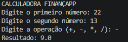
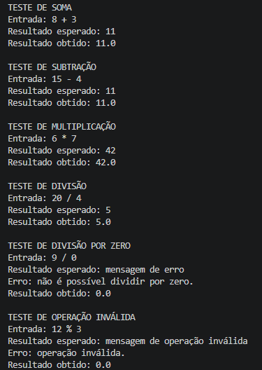

# Projeto Calculadora — FinançApp

> Projeto acadêmico desenvolvido com foco em Qualidade de Software, Testes, Refatoração, Documentação e Versionamento.

---

# 1. Identificação do Projeto

Projeto: Projeto Calculadora  
Contexto: FinançApp  
Aluno: Thomás Ribeiro Jacomaci  
RA: 251545  
Curso: Análise e Desenvolvimento de Sistemas  
Disciplina: UX/UI e Testes de Software  
Professor: Daniel Ohata  
Semestre 4º Semestre  

---

# 2. Visão Geral

O projeto consiste no desenvolvimento de uma calculadora simples em Java para a startup fictícia FinançApp.

A aplicação permite que o próprio usuário informe os dois números e escolha a operação matemática que deseja realizar. Os valores não são fixos no programa.

O módulo pode ser utilizado futuramente em funcionalidades de controle financeiro, como:

- orçamento mensal;
- divisão de despesas;
- projeções financeiras;
- cálculos auxiliares.

Além do funcionamento correto das operações, o projeto aplica práticas relacionadas a:

- testes;
- tratamento de erros;
- refatoração;
- documentação;
- versionamento;
- manutenção de código.

---

# 3. Problema

Durante o desenvolvimento da aplicação FinançApp, foi identificada a necessidade de criar um módulo matemático simples e reutilizável.

O módulo deve permitir que o usuário escolha livremente os valores que deseja calcular e também deve possuir:

- código legível;
- testes das operações;
- tratamento de falhas;
- documentação técnica;
- controle de versões;
- facilidade de manutenção.

---

# 4. Objetivo

## 4.1 Objetivo Geral

Desenvolver uma calculadora em Java aplicando práticas de qualidade, testes, documentação, refatoração e versionamento.

## 4.2 Objetivos Técnicos

- implementar operações matemáticas básicas;
- permitir que o usuário informe os números e a operação;
- impedir divisão por zero;
- tratar operações inválidas;
- executar testes das operações;
- refatorar o código sem alterar seu comportamento;
- documentar classes e métodos com JavaDoc;
- gerar documentação HTML;
- utilizar Git e GitHub;
- manter as branches `main` e `Refatoracao`.

---

# 5. Escopo Funcional

| ID | Funcionalidade | Descrição | Status |
|---|---|---|---|
| RF01 | Entrada de dados | Permite informar dois números pelo terminal | ✅ |
| RF02 | Soma | Soma dois números inteiros | ✅ |
| RF03 | Subtração | Subtrai dois números inteiros | ✅ |
| RF04 | Multiplicação | Multiplica dois números inteiros | ✅ |
| RF05 | Divisão | Divide dois números inteiros | ✅ |
| RF06 | Validação de divisão | Impede divisão por zero | ✅ |
| RF07 | Operação inválida | Trata operadores não suportados | ✅ |

---

# 6. Requisitos Não Funcionais

| ID | Categoria | Requisito |
|---|---|---|
| RNF01 | Qualidade | O código deve possuir organização e legibilidade |
| RNF02 | Testabilidade | As operações devem possuir testes |
| RNF03 | Manutenção | O código deve permitir refatoração sem alteração funcional |
| RNF04 | Documentação | Classes e métodos devem possuir JavaDoc |
| RNF05 | Versionamento | O projeto deve utilizar Git e GitHub |
| RNF06 | Confiabilidade | Erros não devem interromper inesperadamente a execução |

---

# 7. Tecnologias Utilizadas

| Tecnologia | Utilização |
|---|---|
| Java | Desenvolvimento da aplicação |
| JDK | Compilação e execução do código Java |
| VS Code | Ambiente de desenvolvimento |
| Git | Controle de versão |
| GitHub | Repositório remoto |
| JavaDoc | Geração da documentação técnica |

---

# 8. Estrutura do Projeto

```text
projeto_calculadora/
│
├── src/
│   └── calculadora/
│       ├── Calculadora.java
│       ├── Main.java
│       └── TesteCalculadora.java
│
├── docs/
│   └── index.html
│
├── imagens/
│   ├── testes/
│   │   └── testes.png
│   ├── javadoc/
│   │   └── javadoc.png
│   └── execucao/
│       ├── calculadora.png
│       └── multiplicacao.png
│
├── README.md
└── .gitignore
```

---

# 9. Funcionamento da Calculadora

A classe `Main.java` permite que o usuário informe os valores diretamente pelo terminal.

Exemplo de uma execução realizada no projeto:



O usuário pode utilizar outros números e escolher entre as operações:

| Operador | Operação |
|---|---|
| `+` | Soma |
| `-` | Subtração |
| `*` | Multiplicação |
| `/` | Divisão |

O método responsável pelo cálculo é:

```java
calc(int a, int b, String op)
```

Os parâmetros `a` e `b` recebem os números utilizados no cálculo e `op` recebe a operação escolhida.

---

# 10. Tratamento de Erros

## 10.1 Divisão por zero

Quando o segundo número da divisão é zero, o sistema impede a operação e apresenta:

```text
Erro: não é possível dividir por zero.
```

## 10.2 Operação inválida

Caso seja informado um operador diferente de `+`, `-`, `*` ou `/`, o sistema apresenta:

```text
Erro: operação inválida.
```

## 10.3 Entrada inválida

Caso o usuário digite um valor que não seja um número inteiro, o programa trata o erro para evitar que a execução seja interrompida inesperadamente.

---

# 11. Testes

A classe `TesteCalculadora.java` verifica as situações solicitadas na atividade:

- soma;
- subtração;
- multiplicação;
- divisão;
- divisão por zero;
- operação inválida.

Os números utilizados nessa classe são somente **entradas de teste**. Eles não são valores fixos da calculadora.

Em cada teste são exibidos:

- entrada utilizada;
- resultado esperado;
- resultado obtido.

## 11.1 Print da execução dos testes



---

# 12. Refatoração

A versão inicial do código está na branch `main`.

A branch `Refatoracao` contém uma versão reorganizada da classe `Calculadora.java`. Nela, as operações são separadas em métodos próprios:

- `somar`;
- `subtrair`;
- `multiplicar`;
- `dividir`.

Dessa forma, o método `calc` fica responsável por escolher qual operação será executada, enquanto cada método realiza apenas uma tarefa.

Após a refatoração, os mesmos testes devem continuar apresentando os resultados corretos.

---

# 13. Documentação JavaDoc

As classes e métodos do projeto possuem comentários JavaDoc com informações sobre sua finalidade, parâmetros e retornos.

A documentação HTML foi gerada na pasta:

```text
docs/
```

O arquivo inicial é:

```text
docs/index.html
```

## 13.1 Print da documentação JavaDoc


---

# 14. Versionamento

O projeto utiliza Git para controle de versões.

As branches utilizadas são:

- `main` — versão inicial funcional;
- `Refatoracao` — versão reorganizada da classe `Calculadora`.

Os commits foram separados para registrar a versão inicial do projeto e a etapa de refatoração.

---

# 15. Repositório

O projeto deverá ser publicado no GitHub antes da entrega.

**Link do repositório:** COLE AQUI O LINK DO SEU REPOSITÓRIO

---

# 16. Conclusão

Com o desenvolvimento deste projeto foi possível aplicar conceitos básicos de qualidade de software em uma aplicação Java.

Além da implementação das operações matemáticas, foram trabalhados testes, tratamento de erros, refatoração, documentação JavaDoc e versionamento com Git e GitHub.

O projeto também permite que o usuário escolha os números e a operação que deseja realizar, sem depender de valores fixos no código principal.
